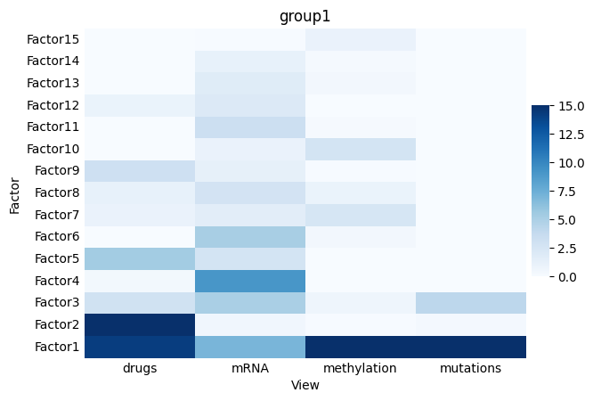
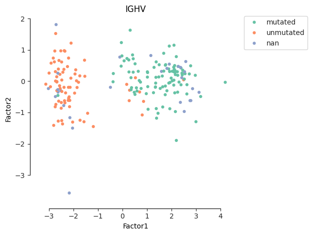
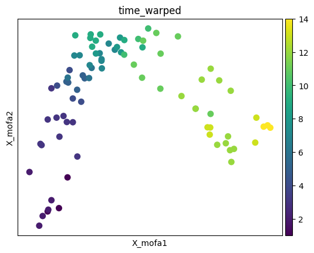
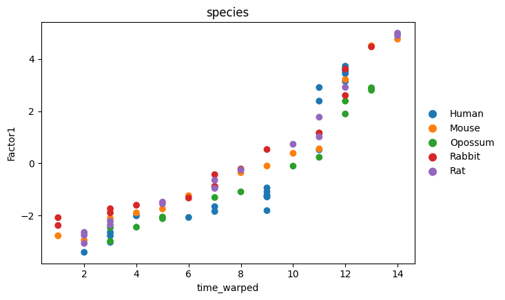
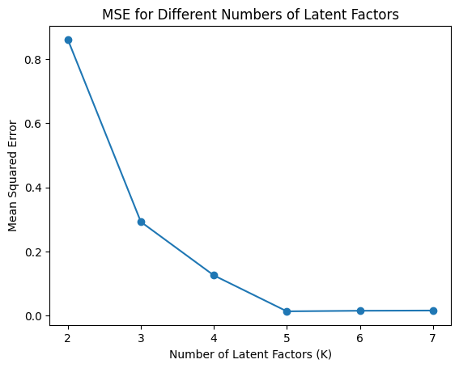
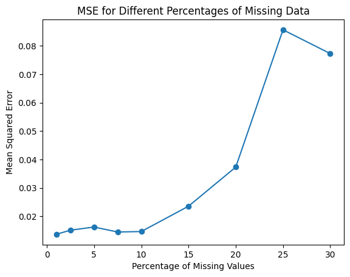

<picture>
  <source media="(prefers-color-scheme: dark)" srcset="assets/visual-abstract-dark.svg">
  
</picture>

<h1 align="center">Multi-Modal Factor Analysis of CLL</h1>

<p align="center">
  Unsupervised integration of four omics layers in chronic lymphocytic leukemia with MOFA+, extended to time-resolved data with MEFISTO and rebuilt from scratch in Pyro
</p>

<p align="center">
  
  
  
  
  
</p>

<p align="center">
  <a href="#overview">Overview</a> &nbsp;·&nbsp; <a href="#results">Results</a> &nbsp;·&nbsp; <a href="#pipeline">Pipeline</a> &nbsp;·&nbsp; <a href="#core-implementation">Core implementation</a> &nbsp;·&nbsp; <a href="#tech-stack">Tech stack</a>
</p>

---

## At a glance

| **200** | **4** | **15 + 5** | **83** | **K = 5** |
|:---:|:---:|:---:|:---:|:---:|
| CLL patients | omics views | factor models compared | MEFISTO samples, 5 species | factors recovered in Pyro |

> **Take-home:** MOFA+ finds a Factor 1 that cleanly separates IGHV-mutated from IGHV-unmutated CLL patients and dominates the methylation and mutation views. In addition, MEFISTO aligns organ development across five species, and a hand-built Pyro factor model recovers the true number of factors from simulated data.

## Skills demonstrated

| Area | Evidence in this repository |
|---|---|
| **Multi-omics integration** | MOFA+ through muon on a MuData object with view-specific likelihoods (Gaussian, Bernoulli) and union-sample alignment |
| **Model interpretation** | Variance decomposition, factor scatter plots and feature weights with mofax, linked to IGHV, trisomy 12 and other clinical data |
| **Temporal modeling** | MEFISTO with a smooth time covariate, species groups, dynamic time warping and factor interpolation |
| **Probabilistic programming** | A Bayesian factor model written in Pyro, trained with SVI (AutoDiagonalNormal guide, Trace_ELBO) and tested for model order and missing data |
| **Python** | Scanpy, muon, mofax, PyTorch, Pyro, pandas, NumPy, seaborn and matplotlib |

## Overview

This repository implements a systems biology pipeline for the **unsupervised integration of multi-omics data** from chronic lymphocytic leukemia (CLL) patients. Multi-Omics Factor Analysis (MOFA+) identifies latent biological drivers that are shared across mRNA expression, DNA methylation, somatic mutations and ex vivo drug response, as well as drivers specific to a single layer.

The notebook then extends the same idea in two directions. First, MEFISTO adds a smooth time covariate to model a longitudinal, multi-species developmental dataset (EvoDevo) with dynamic time warping. Second, a compact Bayesian factor model is written from scratch in Pyro to show how such models are trained with stochastic variational inference.

**Purpose:** practice multi-modal integration and learn how latent factor models connect heterogeneous omics signals to biological and clinical annotations. The key learning goals were choosing sensible likelihoods for each data type (for example Bernoulli for binary mutations), checking factor usefulness with variance explained, and linking sample embeddings to metadata such as IGHV status and trisomy 12.

## Results

### MOFA+ on CLL

| View | Features | Likelihood |
|---|:---:|---|
| mRNA | 5,000 genes | Gaussian |
| DNA methylation | 4,248 CpG sites | Gaussian |
| Mutations | 69 events | Bernoulli (binary) |
| Drug response | 310 drug-concentration pairs | Gaussian (viability between 0 and 1) |

Factor 1 is the dominant factor of the model: it explains the largest share of variance in both the methylation and mutation views (at least 15%, the top of the color scale) and also contributes to drug response. Plotting the samples in factor space shows that Factor 1 separates **IGHV-mutated from IGHV-unmutated** patients, the main prognostic split in CLL.

<p>
  
  
</p>

A constrained 5-factor model was trained alongside the 15-factor model, and their per-view R² tables were compared to see how much structure the smaller model keeps.

### MEFISTO on multi-species development

The EvoDevo dataset contains 83 samples from five species (human 23, mouse 14, opossum 15, rabbit 15, rat 16) across five organs with 7,696 genes each. With dynamic time warping, Factor 1 follows developmental time consistently across species.

<p>
  
  
</p>

### A factor model built in Pyro

On simulated data generated with five latent factors, reconstruction error falls steeply up to K = 5 and then flattens (MSE 0.014 at K = 5), so the model recovers the true dimensionality. Moreover, error stays low until roughly 10 to 15% of values are missing and then rises sharply.

<p>
  
  
</p>

## Pipeline

1. **Load** each modality (mRNA, methylation, mutations, drugs) into AnnData objects and validate their shapes (200 samples in every view).
2. **Combine** them into a MuData container and join clinical metadata (gender, age, TTT, TTD, treatedAfter, died, IGHV, trisomy12).
3. **Train** MOFA+ models with `mu.tl.mofa` (15 factors, plus a 5-factor comparison) and save `.hdf5` models.
4. **Interpret** factors with mofax: variance explained (`plot_r2`), factor scatter plots and feature weights across views.
5. **Model time** with MEFISTO using `smooth_covariate="time"`, `groups_label="species"` and `smooth_warping=True`, then visualize the factor space, interpolation, smoothness and sharedness.
6. **Rebuild** a Bayesian factor model in Pyro (SVI with `AutoDiagonalNormal` and `Trace_ELBO`) and evaluate reconstruction with MSE across model sizes and missing-data levels.

## Core implementation

The central workflow, as implemented in the notebook:

```python
import muon as mu
import mofax as mofa

# Combine the four modalities into one multi-modal object
mdata = mu.MuData(mods)          # mRNA, methylation, mutations, drugs
mdata.obs = mdata.obs.join(CLL_metadata)

# Train MOFA+ on the union of samples
mu.tl.mofa(mdata, use_obs="union", n_factors=15,
           convergence_mode="medium", outfile="models/CLL.hdf5")

# Interpret the trained model
model = mofa.mofa_model("models/CLL.hdf5")
mofa.plot_r2(model, vmax=15)
mofa.plot_factors(model, x="Factor1", y="Factor2", color="IGHV")

# MEFISTO: smooth time covariate with dynamic time warping
mu.tl.mofa(mdata_evodevo, n_factors=5, groups_label="species",
           smooth_covariate="time", smooth_warping=True,
           outfile="models/mefisto.hdf5")
```

## Tech stack

1. **Multi-omics containers and modeling:** Scanpy, muon (MuData, `mu.tl.mofa`)
2. **Factor interpretation:** mofax (`plot_r2`, factor plots, weight plots, interpolation)
3. **Probabilistic modeling:** PyTorch and Pyro (SVI, ELBO, AutoDiagonalNormal)
4. **General:** NumPy, pandas, seaborn and matplotlib

## Repository structure

```
├── Completed_Multi_Modal_exercise.ipynb   # MOFA+, MEFISTO and Pyro analyses
├── assets/
│   ├── visual-abstract-*.svg              # Visual abstract (light and dark)
│   └── figures/                           # Figures exported from the notebook outputs
└── LICENSE
```

## License

Released under the [MIT License](LICENSE). The CLL and EvoDevo data come from the public MOFA tutorials.
